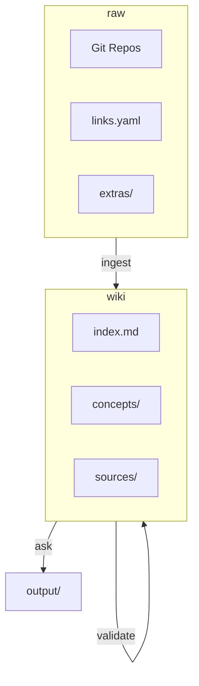

# second-brain

LLM-powered personal knowledge base for Claude Code, Codex, and OpenCode. Raw sources
go in, and a structured Obsidian wiki comes out. One repository can hold one brain at
its root or several named brains under `brains/`.

## How It Works



Every source is read for **referenced links** - URLs found inside documents, Slack threads, and fetched pages get added back to `links.yaml` and processed on the next pass. This recursive crawl follows the full reference graph until no new links are discovered.

## Commands

```
/second-brain-setup [brain] # Bootstrap or update one root or named brain
/second-brain-doctor        # Diagnose or migrate project instructions
/second-brain ingest    # Process raw/ documents into wiki/
/second-brain compile   # Full consistency pass - rebuild index, fix backlinks
/second-brain ask       # Answer a question grounded in wiki content
/second-brain lint      # Health check - find gaps, orphans, contradictions
/second-brain obsidian  # Configure Obsidian and open one brain or the brain hub
```

`ask` and `lint` inspect every discovered brain when run from the project root.
`ingest` and `compile` require one brain when the project contains several. Supply
its path, for example `/second-brain ingest team-a/project-x`.
Setup uses the sole discovered brain automatically. In a multi-brain repository,
supply the target, for example `/second-brain-setup team-a/project-x`.

## Source Types

| Source | How it's ingested |
|--------|-------------------|
| Git repos in `raw/` | Pulled via `raw/pull-all.sh`, read directly |
| `raw/links.yaml` | Fetched by URL - supports wiki pages, help.salesforce.com, web |
| `raw/extras/` | PDFs, PNGs, exported markdown from Slides |
| `raw/slack-queries.yaml` | Searched via Slack MCP tools, links extracted |

## Project Structure

When initialized via `/second-brain-setup`, a wiki project has this layout:

```
project-root/
  AGENTS.md               # Shared project instruction for all three runtimes
  raw/                    # Source documents (you add these)
    links.yaml
    slack-queries.yaml
    extras/
    pull-all.sh
    <git-repos>/
  wiki/                   # Compiled wiki (the active agent maintains)
    index.md
    concepts/
    sources/
    connections.md
  output/                 # Q&A answers, slides, visualizations
```

Multi-brain repositories use the same brain layout under `brains/<name>/`. Names
can be nested, such as `brains/team-a/project-x/`.

## Obsidian

Run `/second-brain obsidian [brain]` from the repository root. The workflow:

- discovers root and nested brains;
- excludes `_template` paths from the brain inventory;
- creates missing portable core settings without replacing user settings;
- keeps shared graph settings in `config/obsidian/graph.json`;
- generates ignored runtime graph and workspace state under `.obsidian/`;
- opens the selected `wiki/index.md`, or `brains/index.md` when several brains exist.

It uses only Obsidian core plugins. It does not install community plugins.

## Installation

```bash
claude plugin marketplace add OWNER/REPO
claude plugin install second-brain@second-brain-marketplace
```

See [INSTALL.md](plugins/second-brain/INSTALL.md) for Claude Code, Codex, and OpenCode installation,
project initialization, and Obsidian setup.

## Plugin Structure

```
plugins/second-brain/
  .claude-plugin/plugin.json           # Plugin metadata
  .codex-plugin/plugin.json            # Native Codex manifest
  AGENTS.md                             # Canonical development instructions
  CLAUDE.md                             # Transition wrapper for Claude Code
  opencode/                             # Built-in adapter, activation, and test
  skills/second-brain/SKILL.md         # Main operator skill
  skills/second-brain-setup/SKILL.md   # Project bootstrap and bounded instructions
  skills/second-brain-doctor/SKILL.md  # Safe CLAUDE.md to AGENTS.md migration
  scripts/obsidian.py                  # Safe Obsidian setup and brain discovery
  reference.md                         # Obsidian visual formatting guide
  tests/                               # Integration and unit tests
```

All three runtimes load the same three files under `skills/`. Runtime adapters contain
only discovery and activation metadata.

Claude Code requires its built-in `agents-md@builtin` plugin. See
[INSTALL.md](plugins/second-brain/INSTALL.md#claude-code) for the fallback rule and configuration scope.

## Tests

```bash
# Unit tests (fast, no remote agent needed)
cd plugins/second-brain/tests && python3 -m unittest -v
```

```bash
# OpenCode adapter test
node --test plugins/second-brain/opencode/test-second-brain.mjs
```

```bash
# Integration runner (runs claude -p against fixtures)
cd plugins/second-brain/tests && ./run.sh

# Validate an existing wiki project
cd plugins/second-brain/tests && ./run.sh --check-only /path/to/project
```
