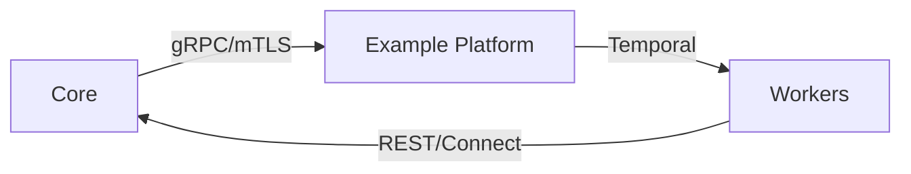

# Visual Representation Guidelines

The wiki is rendered in **Obsidian** with **Dracula theme**. This reference covers all supported visual elements and formatting rules.

Color values follow the [Dracula](https://draculatheme.com) palette, released under the MIT license.

## Mermaid Diagrams

Use Mermaid code blocks for architecture, flows, sequences, and relationships. Preferred diagram types:

| Diagram Type | Use For |
|---|---|
| `flowchart` | System architecture, request flows, decision trees |
| `sequenceDiagram` | Request lifecycles, auth flows, multi-service interactions |
| `classDiagram` | Class hierarchies, interface relationships |
| `stateDiagram-v2` | Workflow states, lifecycle phases |
| `erDiagram` | Data models, entity relationships |
| `graph TD/LR` | Dependency graphs, component relationships |
| `pie` | Proportional breakdowns |
| `mindmap` | Concept maps, topic overviews |
| `timeline` | Chronological events, release history |
| `quadrantChart` | 2-axis comparisons (cost vs isolation, etc.) |
| `gantt` | Phase timelines |

Example:

````

````

## Callouts

Use Obsidian callout syntax for warnings, tips, key insights, and summaries:

| Type | Purpose |
|---|---|
| `> [!note]` | General notes |
| `> [!info]` | Informational context |
| `> [!tip]` / `> [!hint]` | Recommendations, best practices |
| `> [!warning]` / `> [!caution]` | Gotchas, things that break |
| `> [!danger]` / `> [!error]` | Security issues, critical failures |
| `> [!bug]` | Known bugs or quirks |
| `> [!example]` | Code/config examples |
| `> [!question]` / `> [!faq]` | Open questions, things to investigate |
| `> [!abstract]` / `> [!tldr]` | Executive summaries |
| `> [!success]` / `> [!check]` | Confirmed/validated facts |
| `> [!failure]` / `> [!missing]` | Gaps, missing pieces |
| `> [!quote]` | Direct quotes from sources |

Foldable: `> [!type]+` (expanded by default) or `> [!type]-` (collapsed by default)

## Obsidian Formatting

- **Internal links**: `[[concept-name]]` or `[[concept-name|display text]]` — use for cross-references within wiki
- **Tags**: `#example-platform`, `#llm`, `#security` — use in frontmatter or inline for categorization
- **Math**: `$inline$` and `$$block$$` — use for formulas, thresholds, metrics
- **Highlights**: `==highlighted text==` — use for key terms on first mention
- **Task lists**: `- [ ]` / `- [x]` — use in open questions and investigation checklists
- **Footnotes**: `[^1]` — use for source citations when inline links are too noisy
- **Comments**: `%%hidden comment%%` — use for editorial notes not shown in reading view
- **Embeds**: `![[other-article]]` or `![[article#section]]` — use to embed sections from other articles
- **Tables**: standard markdown tables — use for comparisons, catalogs, reference data

## When to Use What

| Content Type | Visual Element |
|---|---|
| System architecture / component relationships | `flowchart` or `graph` |
| Request lifecycle / multi-service flow | `sequenceDiagram` |
| State transitions / workflow phases | `stateDiagram-v2` |
| Class/interface hierarchy | `classDiagram` |
| Tradeoff comparison (2 axes) | `quadrantChart` or table |
| Proportional breakdown | `pie` |
| Topic overview / concept map | `mindmap` |
| Key insight or gotcha | Callout (`[!tip]`, `[!warning]`) |
| Executive summary at top of article | Callout (`[!abstract]`) |
| Open questions / gaps | Callout (`[!question]`) with task list |
| Reference data / catalogs | Tables |
| Metrics / thresholds | Math blocks or inline math |

## Diagram Style Rules (Dracula Theme)

The Obsidian vault uses **Dracula theme** (dark background `#282a36`). All Mermaid diagrams must be styled for dark-mode readability:

- **No `fill:` styles** — let the theme handle node backgrounds. Mermaid's default rendering on Dracula is clean without overrides.
- **No `style` statements** unless absolutely necessary for emphasis. If you must highlight a node, use transparent fills with bright Dracula-palette strokes only:
  - `style NodeName stroke:#bd93f9,stroke-width:2px` (purple accent)
  - `style NodeName stroke:#50fa7b,stroke-width:2px` (green accent)
  - `style NodeName stroke:#ff79c6,stroke-width:2px` (pink accent)
- **Short node labels** — max 3-4 words per line. Use `<br/>` for at most one subtitle line. Move detailed descriptions to a **legend table** below the diagram.
- **Max ~10 nodes** per diagram. If you need more, split into multiple focused diagrams with a brief sentence bridging them.
- **No long text inside subgraph labels** — keep subgraph titles to 1-3 words.
- **Prefer vertical (`TD`) over horizontal (`LR`)**. Vertical diagrams fit Obsidian's scroll direction and don't overflow narrow panes. Use `LR` only when the flow is inherently left-to-right (e.g., a 3-4 node pipeline).
- **Aim for square aspect ratio** — roughly equal width and height. If a vertical diagram gets too tall and skinny, add branching or use subgraphs to add width. If horizontal, it's probably too wide — switch to `TD`.
- **Sequence diagrams**: max 6 participants, max ~12 messages. Split longer flows.
- **Subgraphs**: prefer vertical (`TD`) layout within subgraphs. If subgraphs aren't strictly needed — i.e., two separate diagrams would convey the same information clearly — use separate diagrams with a bridging sentence instead.

## Diagram Placement Rules

- **Every concept article** must have at least one diagram or visual callout
- Place the primary diagram near the top (after any TLDR callout), so the reader sees the big picture first
- Use sequence diagrams for anything involving multiple services or steps
- Use flowcharts for architecture overviews and decision trees
- Tables for reference data and comparisons
- Callouts for key insights, warnings, and open questions

## Images from raw/

The Obsidian vault root is the project directory (not `wiki/`), so images in `raw/extras/` are directly reachable. To embed an image from raw, use standard Markdown image syntax with a path relative to the project directory under `raw/extras/`.

- **Do not copy** images to wiki/ — reference them in place from raw/extras/
- Use URL-encoded paths for filenames with spaces (`%20`)
- Add a brief caption below the image describing what it shows

## Output Diagram Style

Output files follow the same diagram rules as concept articles:

- **No `fill:` or `style` statements** — let the Dracula theme handle colors
- **Max ~10 nodes** per diagram; use a legend table below for detail
- **Short labels** — 3-4 words per node, one `<br/>` subtitle max
- **Prefer vertical (`TD`)** — fits Obsidian's scroll. Use `LR` only for short 3-4 node pipelines
- **Aim for square aspect ratio** — add branching to avoid tall-skinny diagrams
- If you must highlight a node, use stroke only: `style Node stroke:#bd93f9,stroke-width:2px`
